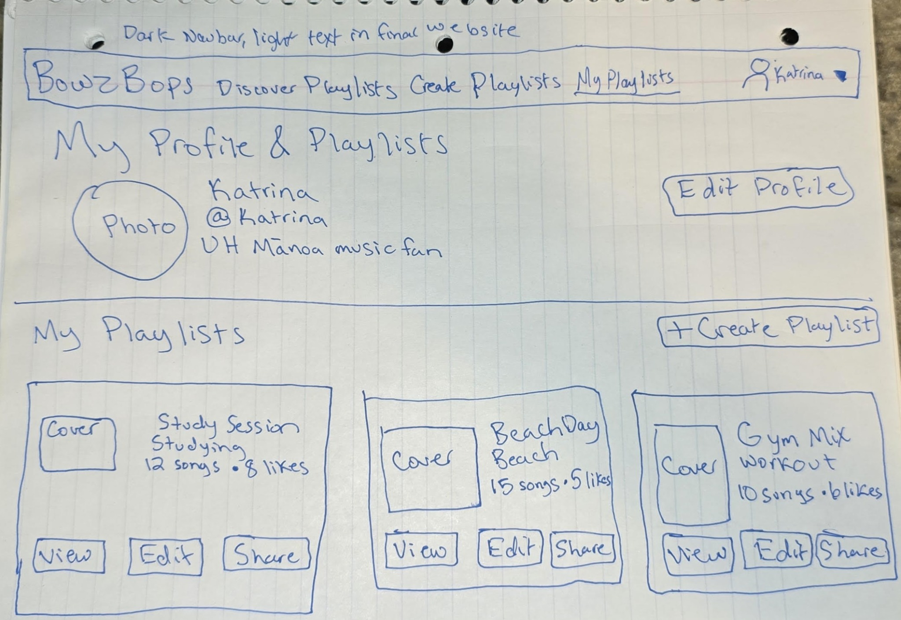

## Overview

Bowz Bops is a music-sharing application for the UH Mānoa
community. Students can create playlists, share their favorite
songs, and discover playlists for studying, working out,
partying, or going to the beach.

Users can organize songs into playlists and provide information
such as the song title, artist, year, genre, and an optional
Spotify or YouTube link. They can browse other users' playlists
and like their favorites.

Bowz Bops focuses on music shared by the campus community.
User profiles, personal playlists, and likes provide an
individual experience, while category rankings help students
discover popular playlists.

### Project Links

- [GitHub Organization](https://github.com/bowz-bops)
- [Application Repository](https://github.com/bowz-bops/bowz-bops)
- [Documentation Repository](https://github.com/bowz-bops/bowz-bops.github.io)

### Team Contract

Team Contract link: To be added.

## Deployment

The deployed application link will be added after the initial
Vercel deployment.

## User Guide

The initial release will include a landing page and mockups of
at least four additional pages. Features described below are
planned until implemented.

### Landing Page

Introduces Bowz Bops and its main features, with a Log in link to the separate login page.

Screenshot: To be added.

### Login Page

Provides labeled email and password fields and a Log in button, with navigation back to the landing page. This is a visual mockup for M1; authentication behavior will follow the team's agreed milestone scope.

Selecting **Create an Account** on the Login page will open a registration dialog with fields for name, email, password, and password confirmation, along with Create Account and Cancel buttons. This is a planned feature and will not require a separate page.

Screenshot: To be added.

### Discover Playlists

Allows users to browse playlists by activity or category and
view popular playlists.

Screenshot: To be added.

### Playlist Details

Displays a playlist's songs, creator, category, and likes.

Screenshot: To be added.

### Create or Edit Playlist

Allows users to enter playlist information and organize songs.

Screenshot: To be added.

### My Profile and Playlists

Displays the signed-in user's profile and personal playlists. The proposed
layout includes profile information and playlist cards with categories,
song counts, likes, and View, Edit, and Share controls, plus a Create Playlist
button.

**Paper mockup:** The image below illustrates the proposed page layout for
the presentation. It uses sample data; the controls and features shown are
planned and are not evidence of implemented functionality.

*Paper mockup by Katrina Flessas.*

Selecting **Edit Profile** will open a small dialog with fields for updating
profile information, such as name, username, bio, and an optional photo URL,
with Save Changes and Cancel buttons. Selecting **Share** on a playlist card
will open a dialog displaying that playlist's link, with Copy Link and Close
buttons. These are planned features and will not require separate pages.

Selecting **Edit** on a playlist card will open the separate **Create or Edit
Playlist** page to update that playlist and its songs. The **Edit Profile**
dialog updates profile information only.

## Community Feedback

Community feedback has not yet been collected.

This section will describe feedback from UH Mānoa users and
changes made in response to their suggestions.

## Developer Guide

### Technology

- Next.js
- React
- Bootstrap 5
- PostgreSQL
- Prisma
- GitHub
- Vercel

### Local Installation

Setup instructions will be added after the application
repository is initialized and the team verifies the process.

The completed guide will explain:
1. Required software and versions.
2. How to clone the application repository.
3. How to install dependencies.
4. How to configure local environment variables.
5. How to create and initialize the database.
6. How to run the application locally.
7. How to run the project's checks.

### Deployment Instructions

Verified Vercel deployment instructions will be added here,
including required environment variable names and database
setup. Secret values will not be published.

## Development History

### Milestone 1

Milestone 1 establishes the foundation of Bowz Bops through initial
application setup and deployment, a landing page, and visual mockups
for login, playlist discovery, playlist details, playlist creation and
editing, and user profiles and personal playlists. It also includes
project documentation, page screenshots, and verified setup instructions.
The team tracks assignments and progress on the M1 project board.

[View the M1 Project Board](https://github.com/orgs/bowz-bops/projects/1/views/2)

### Milestone 2

The second milestone's planned work will be documented here
when the team transitions to M2.

M2 Project board link: To be added.

## Contact Us

Bowz Bops is developed by three UH Mānoa students.

  

    
    <strong>Kenneth Hironaka</strong>
    <a href="https://github.com/kenneth-hironaka">@kenneth-hironaka</a>
  

  

    
    <strong>Timothy Lovejoy</strong>
    <a href="https://github.com/LyingCakes">@LyingCakes</a>
  

  

    
    <strong>Katrina Flessas</strong>
    <a href="https://github.com/katrinaflessas">@katrinaflessas</a>
  

For questions or feedback, please
[open an issue](https://github.com/bowz-bops/bowz-bops/issues).
