## Overview

Bowz Bops is a music-sharing application for the UH Mānoa
community. Students can create playlists, share their favorite
songs, and discover playlists for studying, working out,
partying, or going to the beach.

Users can organize songs into playlists and provide information
such as the song title, artist, year, genre, and an optional
Spotify or YouTube link. They can browse other users' playlists
and like their favorites.

Bowz Bops focuses on music shared by the campus community.
User profiles, personal playlists, and likes provide an
individual experience, while category rankings help students
discover popular playlists.

### Project Links

- [GitHub Organization](https://github.com/bowz-bops)
- [Application Repository](https://github.com/bowz-bops/bowz-bops)
- [Documentation Repository](https://github.com/bowz-bops/bowz-bops.github.io)

### Team Contract

[Read our signed Team Contract](https://docs.google.com/document/d/1ABdf0wHjsd3Jak8W_jqSBIyNmYgeHcjmLPMzYItvUhA/edit?usp=drivesdk)

Our team contract records our agreed contribution and behavior expectations,
conflict-resolution process, and each member's signature. It is publicly
accessible with read-only access.

## Deployment

[Visit the live Bowz Bops application](https://bowz-bops.vercel.app/).

The application is hosted on Vercel. The live app includes the M1 My Playlists and Leaderboard mockups.

## User Guide

The initial release will include a landing page and mockups of
at least four additional pages. Features described below are
planned until implemented. The paper sketches document the proposed designs
for the team presentation; they do not demonstrate completed application pages.
Application webpage mockups are tracked separately on the M1 board.

### Landing Page

Introduces Bowz Bops with buttons to sign in and create an account (see Sign In Page and Create Account pages below).

**Paper mockup:**

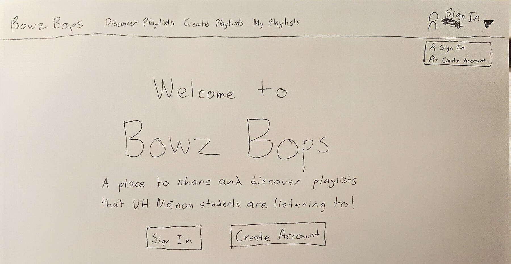

*Paper mockup by Kenneth Hironaka.*

### Sign In Page

Provides labeled email and password fields and a Sign In button, with navigation back to the landing page. This is a visual mockup for M1; authentication behavior will follow the team's agreed milestone scope.

Selecting the link to create an account on the Sign In page will redirect users to a separate Create Account page (see Create Account Page mockup). 

**Paper mockup:**

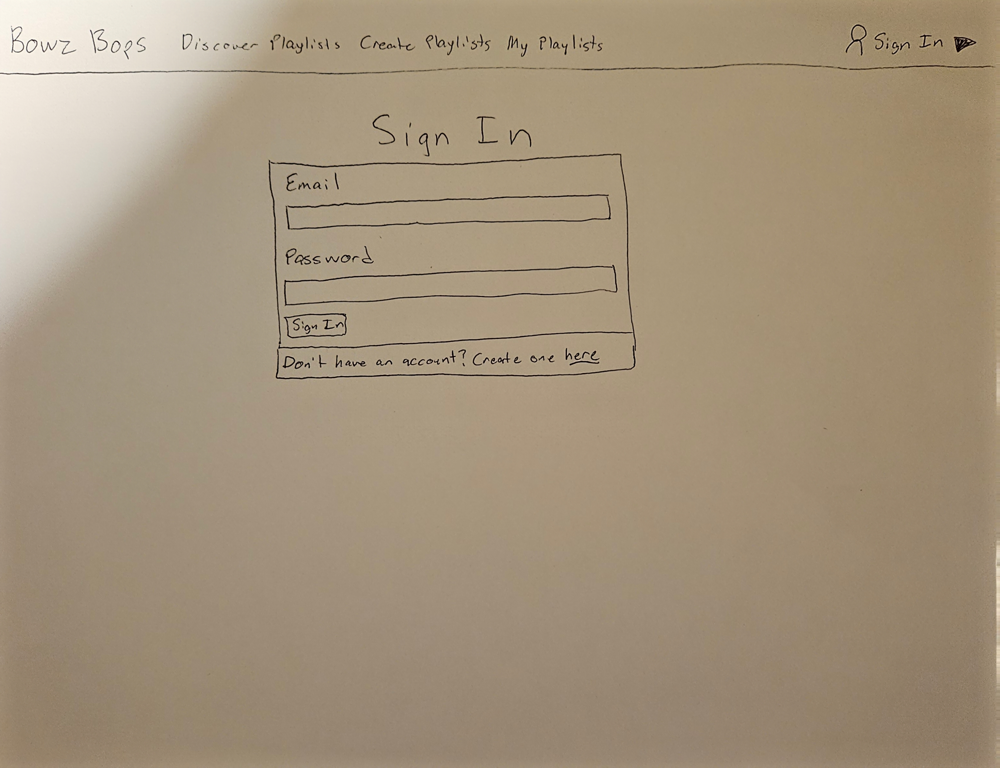

*Paper mockup by Kenneth Hironaka.*

### Create Account Page

Provides labeled email, username, display name, password, and confirm password fields along with a "Create Account" button. The planned behavior is to create an account, sign the user in, and open My Profile and Playlists; this paper mockup does not implement registration.

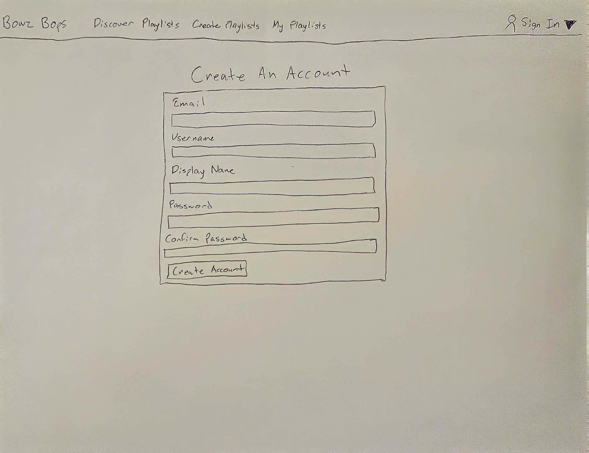

*Paper mockup by Kenneth Hironaka.*

### Discover Playlists

**Planned playlist categories**

- Studying
- Commuting
- Beach
- Workout
- Chill
- Party
- Throwbacks

Allows users to browse playlists by activity or category and view popular playlists
ranked by likes within each category. Selecting a playlist title opens the separate
Playlist Details page. Signed-in users can like playlists and use **Save** to bookmark
other users' playlists. The location for displaying saved playlists is still to be
agreed by the team; saving does not transfer ownership or grant editing access.

**Paper mockup:**

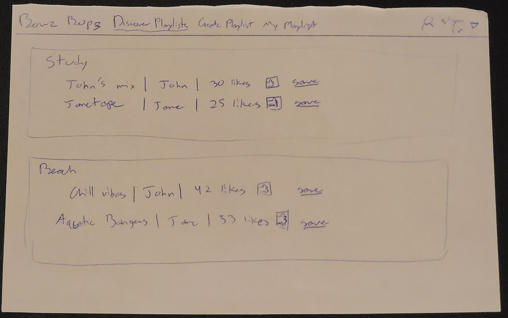

*Paper mockup by Timothy Lovejoy.*

### Playlist Details

Displays one selected playlist, including its title, creator, category, cover image,
last-updated date, and songs. Song information includes title, artist, year, genre,
and an optional Spotify or YouTube link. The proposed page will also show a
playlist like count and Like control, although these are not drawn in the current
paper sketch. This is distinct from My Profile and Playlists, which lists the
signed-in user's own playlists.

**Paper mockup:**

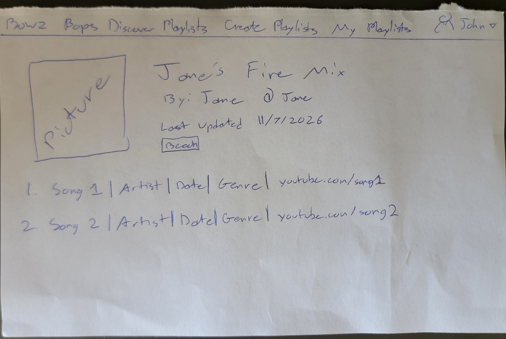

*Paper mockup by Timothy Lovejoy.*

### Create or Edit Playlist

Allows signed-in users to create playlists and edit playlists they own. The form
includes playlist name, category, and the proposed visibility setting, plus song
title, artist, year, genre, and an optional Spotify or YouTube link. **Enter** adds a
song to the working list; the trash control removes one. **Save** stores playlist
information, while **Finish** on the creation sketch completes the creation flow.
The exact save flow and visibility options will be finalized during implementation.

Selecting **Edit** on a playlist card will open this separate **Create or Edit
Playlist** page to update that playlist and its songs. Selecting **Create
Playlist** will open the page with a blank form for a new playlist. This page
is separate from the Edit Profile dialog, which updates profile information only.

**Paper mockup:**

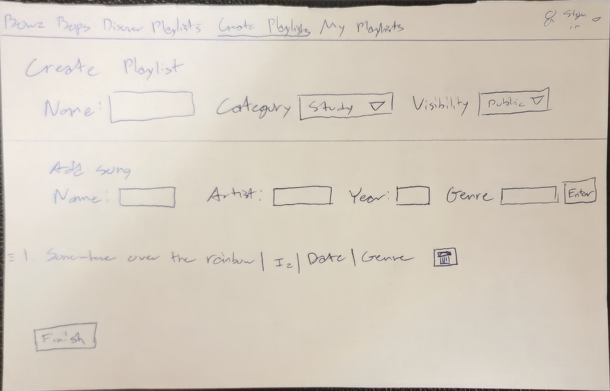

*Paper mockup by Timothy Lovejoy.*

**Paper mockup:**

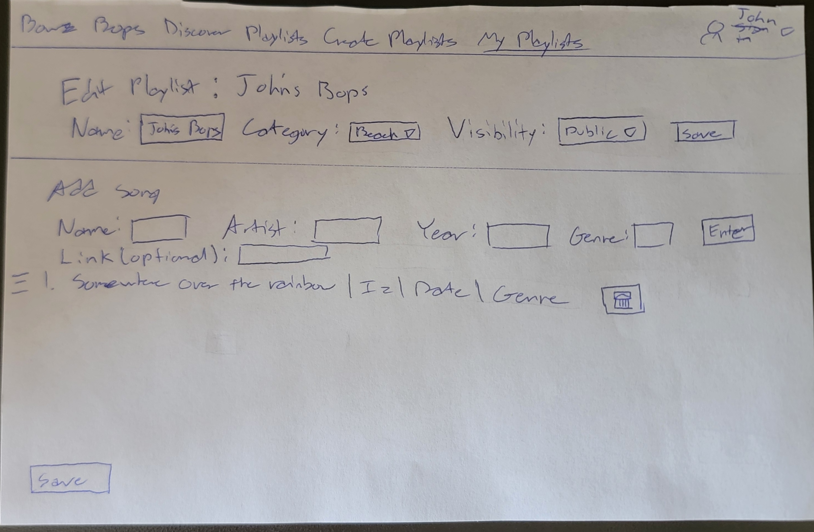

*Paper mockup by Timothy Lovejoy.*

### My Profile and Playlists

The M1 mockup shows a sample student profile, a searchable and sortable collection of owned playlists, and a **Saved Playlists** section underneath. Playlist cards show cover art, categories, song counts, and likes. **View** opens a sample track list, and **Share** opens a dialog with a copyable link and sharing icons.

**Edit Profile** lets you preview changes to the display name, username, bio, profile picture, and banner. **Create Playlist** and **Edit** show notices for the planned forms. Profile edits and saved selections reset when you refresh.

[Open the My Playlists mockup](https://bowz-bops.vercel.app/my-playlists)

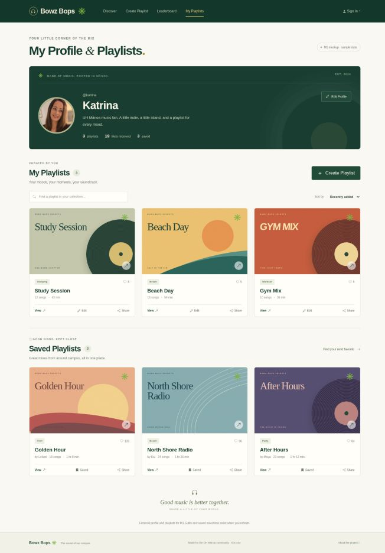

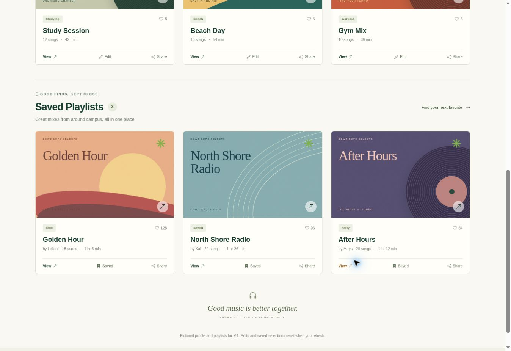

### Leaderboard

The M1 Leaderboard ranks sample campus playlists by likes, highlights the top three, and shows the rest in **The full rotation**. Choose a category to filter the rankings, select a playlist to preview its tracks, or click a creator’s name to browse their other sample playlists. The like and save buttons demonstrate the interaction using temporary state.

[Open the Leaderboard mockup](https://bowz-bops.vercel.app/leaderboard)

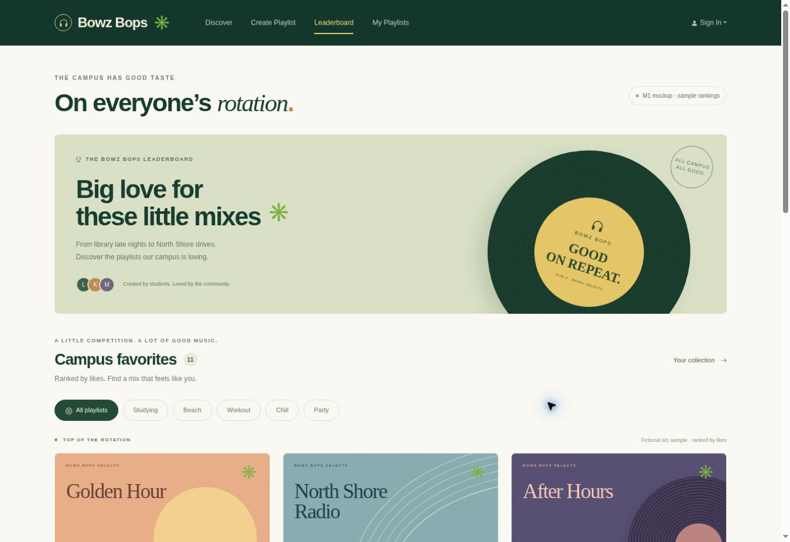

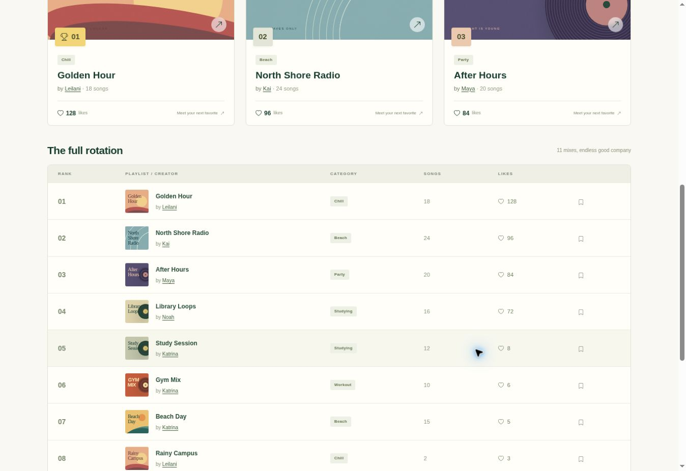

## Community Feedback

Community feedback has not yet been collected.

This section will describe feedback from UH Mānoa users and
changes made in response to their suggestions.

## Developer Guide

### Technology

- Next.js
- React
- Bootstrap 5
- PostgreSQL
- Prisma
- GitHub
- Vercel

### Local Installation

Setup instructions will be added after the application
repository is initialized and the team verifies the process.

The completed guide will explain:
1. Required software and versions.
2. How to clone the application repository.
3. How to install dependencies.
4. How to configure local environment variables.
5. How to create and initialize the database.
6. How to run the application locally.
7. How to run the project's checks.

### Deployment Instructions

Verified Vercel deployment instructions will be added here,
including required environment variable names and database
setup. Secret values will not be published.

## Development History

### Milestone 1

Milestone 1 establishes the foundation of Bowz Bops through initial
application setup and deployment, a landing page, and visual mockups
for sign-in, playlist discovery, playlist details, playlist creation and
editing, and user profiles and personal playlists. It also includes
project documentation, page screenshots, and verified setup instructions.
The team tracks assignments and progress on the M1 project board.

[View the M1 Project Board](https://github.com/orgs/bowz-bops/projects/1/views/2)

### Milestone 2

The second milestone's planned work will be documented here
when the team transitions to M2.

M2 Project board link: To be added.

## Contact Us

Bowz Bops is developed by four UH Mānoa students.

  

    
    <strong>Kenneth Hironaka</strong>
    <a href="https://github.com/kenneth-hironaka">@kenneth-hironaka</a>
  

  

    
    <strong>Timothy Lovejoy</strong>
    <a href="https://github.com/LyingCakes">@LyingCakes</a>
  

  

    
    <strong>Katrina Flessas</strong>
    <a href="https://github.com/katrinaflessas">@katrinaflessas</a>
  

  

    <strong>Mona Mutzenberg</strong>
  

For questions or feedback, please
[open an issue](https://github.com/bowz-bops/bowz-bops/issues).

