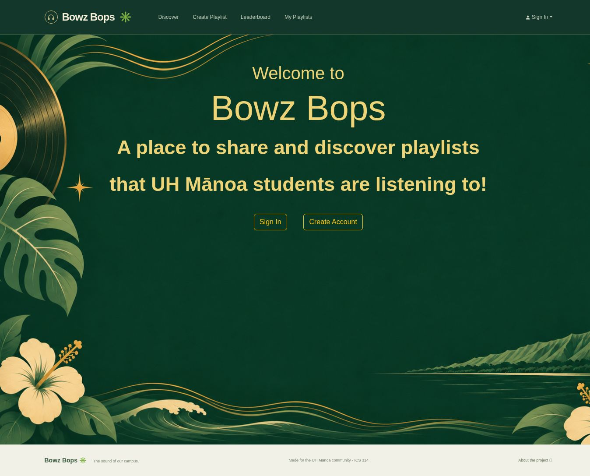
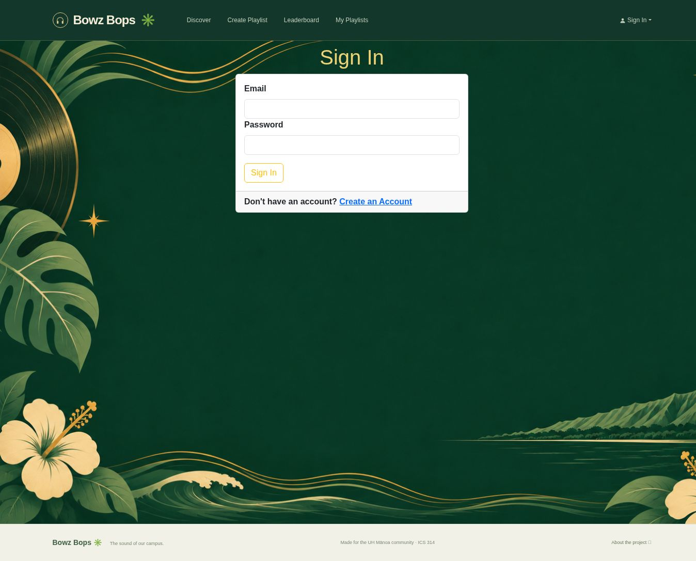
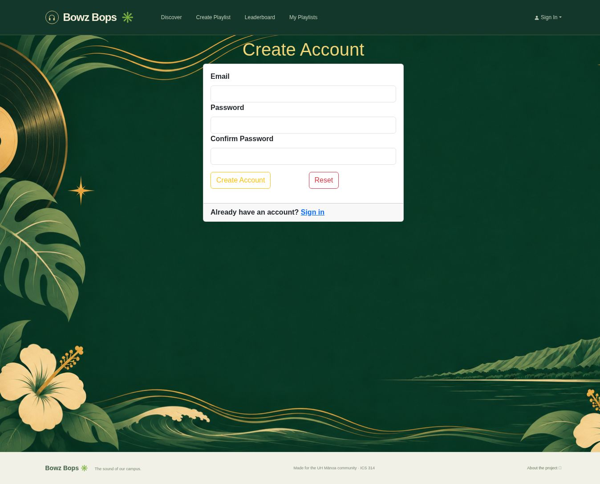
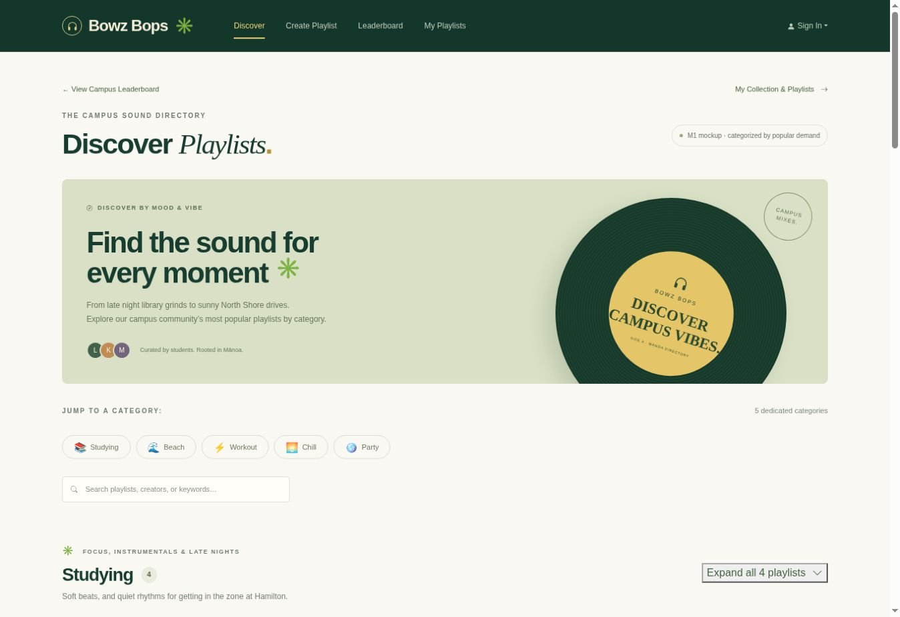
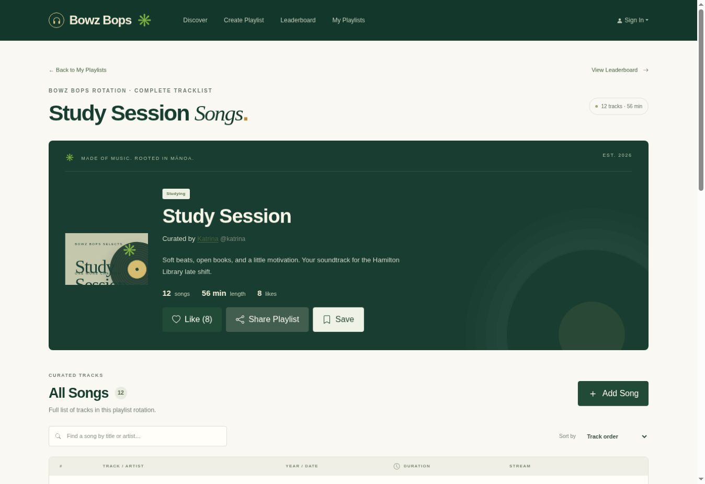
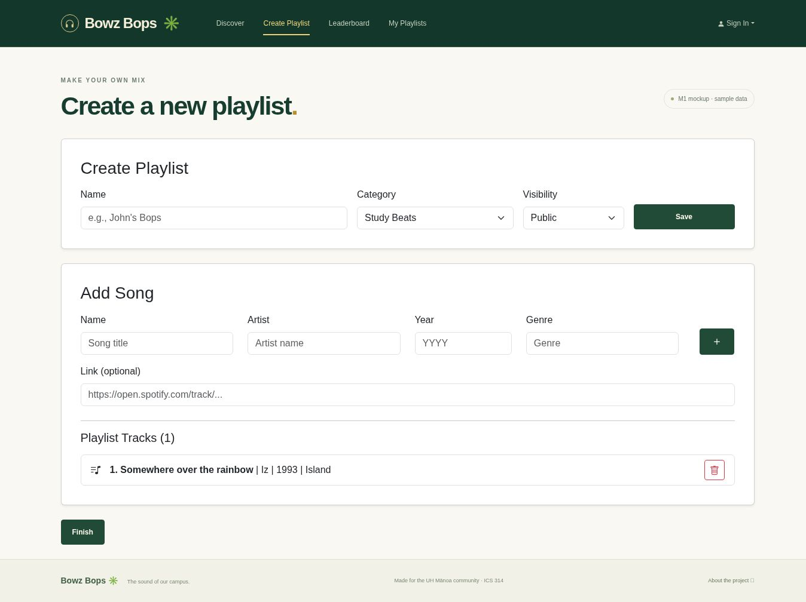
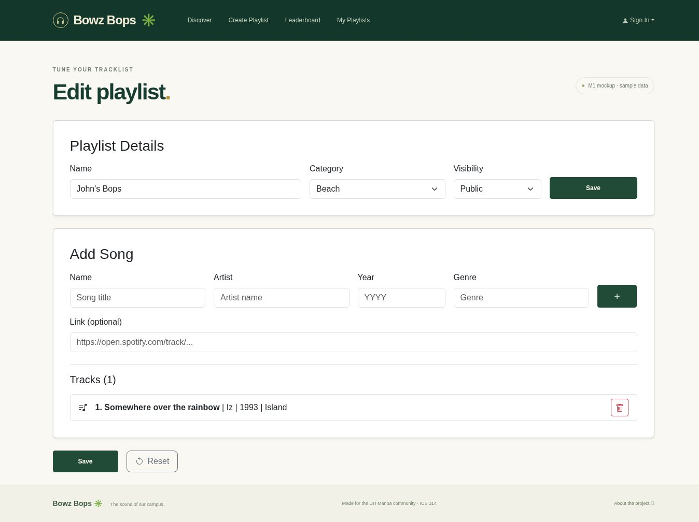
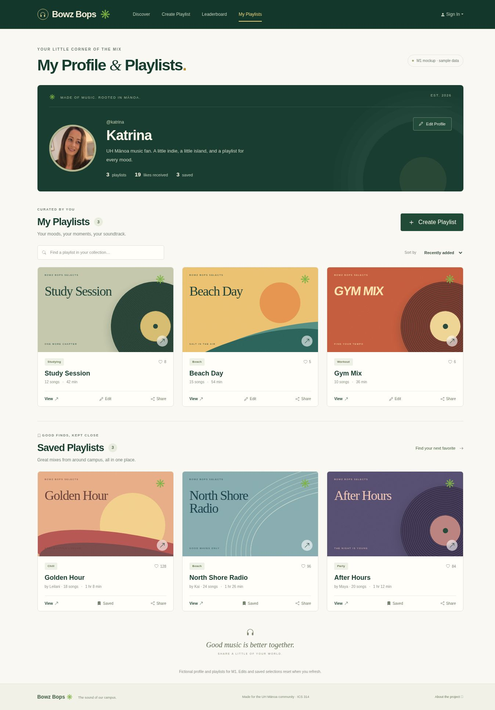
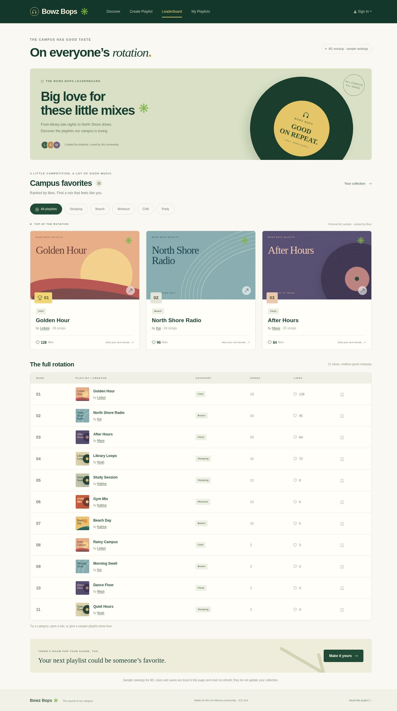

## Overview

Bowz Bops is a music-sharing application for the UH Mānoa
community. Students can create playlists, share their favorite
songs, and discover playlists for studying, working out,
partying, or going to the beach.

Users can organize songs into playlists and provide information
such as the song title, artist, year, genre, and an optional
Spotify or YouTube link. They can browse other users' playlists
and like their favorites.

Bowz Bops focuses on music shared by the campus community.
User profiles, personal playlists, and likes provide an
individual experience, while category rankings help students
discover popular playlists.

### Project Links

- [GitHub Organization](https://github.com/bowz-bops)
- [Application Repository](https://github.com/bowz-bops/bowz-bops)
- [Documentation Repository](https://github.com/bowz-bops/bowz-bops.github.io)

### Team Contract

[Read our signed Team Contract](https://docs.google.com/document/d/1ABdf0wHjsd3Jak8W_jqSBIyNmYgeHcjmLPMzYItvUhA/edit?usp=drivesdk)

Our team contract records our agreed contribution and behavior expectations,
conflict-resolution process, and each member's signature. It is publicly
accessible with read-only access.

## Deployment

[Visit the live Bowz Bops application](https://bowz-bops.vercel.app/).

The application is hosted on Vercel. The live app includes the M1 My Playlists and Leaderboard mockups.

## User Guide

These screenshots were captured from the deployed application on November 19, 2026.
The M1 pages demonstrate the navigation, layout, and intended interactions.
Playlist likes, saves, profile edits, and form changes are demonstrations and do
not persist to the database or synchronize between pages. Refreshing resets them.
Playback controls are visual demonstrations, not an audio streaming service.

### Landing Page

The landing page introduces Bowz Bops with a tropical, vinyl-inspired background
and buttons for **Sign In** and **Create Account**. The shared navbar links to
Discover, Create Playlist, Leaderboard, and My Playlists.

[Open the landing page](https://bowz-bops.vercel.app/)

*Landing page by Kenneth Hironaka.*

### Sign In Page

Enter an email and password to use the existing account authentication flow.
The page includes a link to Create Account and uses the landing page's background
and shared navigation. Live seed passwords are shared privately, not in this guide.

[Open Sign In](https://bowz-bops.vercel.app/auth/signin)

### Create Account Page

The current registration form has **Email**, **Password**, and **Confirm Password**
fields, along with **Create Account**, **Reset**, and a link back to Sign In.
Username and display-name fields from the original paper sketch are not part of
this version. This screen documents the current account form, not completed
playlist or profile database integration.

[Open Create Account](https://bowz-bops.vercel.app/auth/signup)

*Account page styling by Kenneth Hironaka.*

### Discover Playlists

Browse fictional campus playlists grouped into **Studying**, **Beach**,
**Workout**, **Chill**, and **Party**. Category shortcuts jump to each section;
search narrows the sample collection, and expandable sections reveal additional
playlists. Cards include creator links, a playlist preview, and temporary Like,
Save, and Share controls. The separate Playlist Details page provides a longer
track-list view.

The team's planned category set also includes **Commuting** and **Throwbacks**;
those two categories are not yet shown in this Discover mockup. The create/edit
forms also still contain some earlier category labels, to be aligned in M2.

[Open Discover Playlists](https://bowz-bops.vercel.app/discover)

*Discover mockup by Timothy Lovejoy.*

### Playlist Details

The detail view shows a sample playlist's cover, title, creator, category,
description, likes, track count, and total duration. The track table includes
song titles, artists, years, durations, and example external listening links.
Search, sorting, playlist selection, and temporary like/save/share controls
demonstrate the intended experience. Play/pause controls do not stream audio,
and some external links are examples rather than song-specific destinations.
**Add Song** currently opens a notice for future database integration.

[Open Playlist Details](https://bowz-bops.vercel.app/playlist-details)

*Playlist Details mockup by Timothy Lovejoy.*

### Create Playlist

The creation form has playlist name, category, visibility, and song fields for
title, artist, year, genre, and an optional link. The plus button adds a song to
the working list and the trash button removes it. **Save** and **Finish** display
local feedback; they do not create a database record. One sample track is present
initially. Use the navbar's **Create Playlist** link to open this page; the button
inside My Playlists still displays its original placeholder notice.

[Open Create Playlist](https://bowz-bops.vercel.app/create-playlist)

### Edit Playlist

The edit form starts with the sample **John's Bops** playlist. Users can change
its name, category, visibility, and working track list, then try **Save** or
**Reset**. The **Edit** buttons on My Playlists now open this page, but they do not
yet load the selected card's data. Loading the selected playlist, enforcing
ownership, and saving changes to PostgreSQL are M2 work.

[Open Edit Playlist](https://bowz-bops.vercel.app/edit-playlist)

*Create and Edit webpage mockups by Mona Mutzenberg, based on the team's paper designs.*

### My Profile and Playlists

The sample profile appears above a searchable, sortable collection of owned
playlists. **Saved Playlists** is underneath the owned collection. Cards show
illustrated cover art, category, song count, and likes. **View** opens a sample
track dialog; **Edit** opens the separate edit-page mockup.

**Edit Profile** previews changes to name, username, bio, profile picture, and
background. **Share** provides a copyable link and Facebook, Twitter/X, Instagram,
Spotify, and YouTube icons. Facebook and X open sharing destinations; the other
icons copy the link with instructions. These controls do not publish directly to
all of those services. Removing a saved playlist offers Undo. Profile and saved
changes are local to this page and reset on refresh.

[Open My Playlists](https://bowz-bops.vercel.app/my-playlists)

*My Playlists mockup by Katrina Flessas.*

### Leaderboard

The Leaderboard highlights the top three sample playlists and lists all sample
rankings in **The full rotation**. Category filters narrow the list; playlist
controls open track previews, and creator links open sample creator profiles.
Like and save controls demonstrate local state only and do not update the My
Playlists collection or a database-backed ranking.

[Open Leaderboard](https://bowz-bops.vercel.app/leaderboard)

*Initial Leaderboard mockup by Katrina Flessas; Mona Mutzenberg owns its M2 development.*

### Original Paper Designs

The initial sketches remain available for comparison with the implemented M1 mockups:
[Landing](images/mockups/landing-page-mockup.jpg),
[Sign In](images/mockups/sign-in-mockup.jpg),
[Create Account](images/mockups/create-account-mockup.jpg),
[Discover](images/mockups/discover-playlists-mockup.jpg),
[Playlist Details](images/mockups/display-playlist-mockup.jpg),
[Create Playlist](images/mockups/create-playlist-mockup.jpg),
[Edit Playlist](images/mockups/edit-playlist-mockup.jpg), and
[My Playlists](images/mockups/profile-my-playlists.jpg).

## Community Feedback

Community feedback has not yet been collected.

This section will describe feedback from UH Mānoa users and
changes made in response to their suggestions.

## Developer Guide

### Technology

- Next.js
- React
- Bootstrap 5
- PostgreSQL
- Prisma
- GitHub
- Vercel
- Neon (hosted PostgreSQL)

### Local Installation

Setup instructions will be added after the application
repository is initialized and the team verifies the process.

The completed guide will explain:
1. Required software and versions.
2. How to clone the application repository.
3. How to install dependencies.
4. How to configure local environment variables.
5. How to create and initialize the database.
6. How to run the application locally.
7. How to run the project's checks.

### Deployment Instructions

Verified Vercel deployment instructions will be added here,
including required environment variable names and database
setup. Secret values will not be published.

## Development History

### Milestone 1

Milestone 1 establishes the foundation of Bowz Bops through initial
application setup and deployment, a landing page, and visual mockups
for sign-in, playlist discovery, playlist details, playlist creation and
editing, and user profiles and personal playlists. It also includes
project documentation, page screenshots, and verified setup instructions.
The team tracks assignments and progress on the M1 project board.

[View the M1 Project Board](https://github.com/orgs/bowz-bops/projects/1/views/2)

### Milestone 2

M2 will introduce shared playlist models and fictional seed data, connect the
page mockups to PostgreSQL, and implement persistent playlist creation, editing,
saving, profile changes, and leaderboard likes. Page owners will update their
Playwright coverage alongside their features. Documentation and screenshots will
be refreshed as working features are merged.

[View the M2 Project Board](https://github.com/orgs/bowz-bops/projects/3/views/2)

## Contact Us

Bowz Bops is developed by four UH Mānoa students.

  

    
    <strong>Kenneth Hironaka</strong>
    <a href="https://github.com/kenneth-hironaka">@kenneth-hironaka</a>
  

  

    
    <strong>Timothy Lovejoy</strong>
    <a href="https://github.com/LyingCakes">@LyingCakes</a>
  

  

    
    <strong>Katrina Flessas</strong>
    <a href="https://github.com/katrinaflessas">@katrinaflessas</a>
  

  

    
    <strong>Mona Mutzenberg</strong>
    <a href="https://github.com/mmutze">@mmutze</a>
  

For questions or feedback, please
[open an issue](https://github.com/bowz-bops/bowz-bops/issues).

